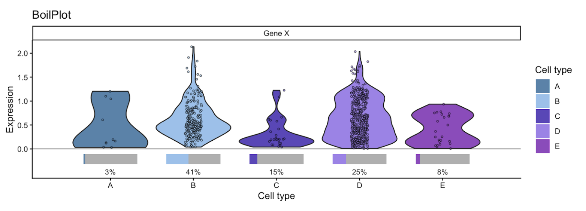

# BoilPlot



An R utility for faithful and interpretable visualisations of zero-inflated distributions (typical for single-cell gene expressions) stored in a [**`SeuratObj`**](https://www.rdocumentation.org/packages/SeuratObject/) object.

This is an R implementation of the original Python package, [available here](https://github.com/laraj1/boilplot-python).

## Description

Single-cell expression data is typically dominated by zeros. This makes conventional distribution plots often difficult to read, and sometimes downright misleading.

There are really two pieces of information:

-   How many cells express the gene?

-   What is the expression distribution among those cells?

Boil plots visually separate the two, resulting in more faithful and interpretable visual representations. (A similar separation is already widely adopted in dot plot marker visualisations of single-cell data.)

For a more in-depth explanation, see the [original Python implementation](https://github.com/laraj1/boilplot-python).

## Getting Started

### Installation

The package can be installed directly from GitHub:

```         
install.packages("remotes")

remotes::install_github("laraj1/boilplot-r")
```

The required dependencies are installed automatically.

### Example

```         
library(SeuratObject)
library(boilplot)

data("pbmc_small")

p <- boil_plot(
  pbmc_small,
  genes = c("CST3", "NKG7", "PPBP"),
  category = "RNA_snn_res.1",
)

print(p)
```

### Further customization

The implementation supports further customization by adding a title, specifying the order of categories (with any categories not listed excluded from the plot), specifying a colour palette, ...

```         
p <- boil_plot(
  pbmc_small,
  genes=c("GZMA", "NKG7", "PRF1"),
  category="RNA_snn_res.1",
  title='NK cytotoxicity markers',
  category_order=c('2', '1', '0'),
  palette=c(
    '0' = '#525174',
    '1' = '#348aa7',
    '2' = '#bce784'
  )
)
print(p)
```

The general appearance of the plot can be further modified via the ggplot2 package functionality, e.g.:

```         
library(ggplot2)

p <- (
  p
  + theme_minimal()
  + theme(
    # Overall text
    axis_title=element_text(size=14),
    axis_text=element_text(size=11),
    axis.text.x = element_text(angle = 45, hjust = 1),
    
    # Facet/panel labels
    strip_text=element_text(size=14),
    
    # Legend
    legend_title=element_text(size=12),
    legend_text=element_text(size=11),
    
    # Plot title
    plot_title=element_text(size=16),
  )
  + labs(
    x="Cell type",
    fill="Cell type",
  )
)
print(p)
```

## API

### `boil_plot()`

| Parameter        | Type                               | Default  | Description                                                                                                                |
|------------------|------------------|------------------|------------------|
| `object`         | `Seurat`                           | ---      | Seurat object containing expression data.                                                                                  |
| `genes`          | `character` or `character vector`  | ---      | Gene or genes to plot.                                                                                                     |
| `category`       | `character`                        | ---      | Column in the Seurat object's metadata containing the categories to compare.                                               |
| `assay`          | `character` or `NULL`              | `NULL`   | Assay from which expression is extracted. If**`NULL`**, the object's default assay is used.                                |
| `layer`          | `character`                        | `"data"` | Expression layer to use. In Seurat v4, this is mapped to the corresponding assay slot.                                     |
| `palette`        | `named character vector` or `NULL` | `NULL`   | Mapping of category names to colours. If `NULL`, colours are generated automatically.                                      |
| `category_order` | `character vector` or `NULL`       | `NULL`   | Optional explicit order of categories on the x-axis. Any categories missing from the order will be excluded from the plot. |
| `min_nonzero`    | `integer`                          | `10`     | Minimum number of non-zero observations required for a violin to be shown for a gene/category combination.                 |
| `title`          | `character` or **`NULL`**          | `NULL`   | Optional plot title.                                                                                                       |
| `point_size`     | `numeric`                          | `0.7`    | Size of jittered points.                                                                                                   |
| `point_alpha`    | `numeric`                          | `0.6`    | Transparency of jittered points.                                                                                           |
| `jitter_width`   | `numeric`                          | `0.1`    | Horizontal jitter applied to strip plot points.                                                                            |

### Returns

`plotnine.ggplot`

A plotnine `ggplot` object containing the resulting visualisation.

### Visualisation components

| Component        | Represents                                                 |
|------------------------------------|------------------------------------|
| Violin           | Distribution of non-zero expression values.                |
| Jittered points  | Individual non-zero observations.                          |
| Grey bar         | Full range corresponding to 100% of observations.          |
| Coloured bar     | Proportion of observations with non-zero expression.       |
| Percentage label | Exact proportion of observations with non-zero expression. |

## Authors

[Lara Jerman](https://www.linkedin.com/in/larajerman/)

## Version History

-   0.1.0
    -   Initial Release

## License

This project is licensed under the MIT License.
